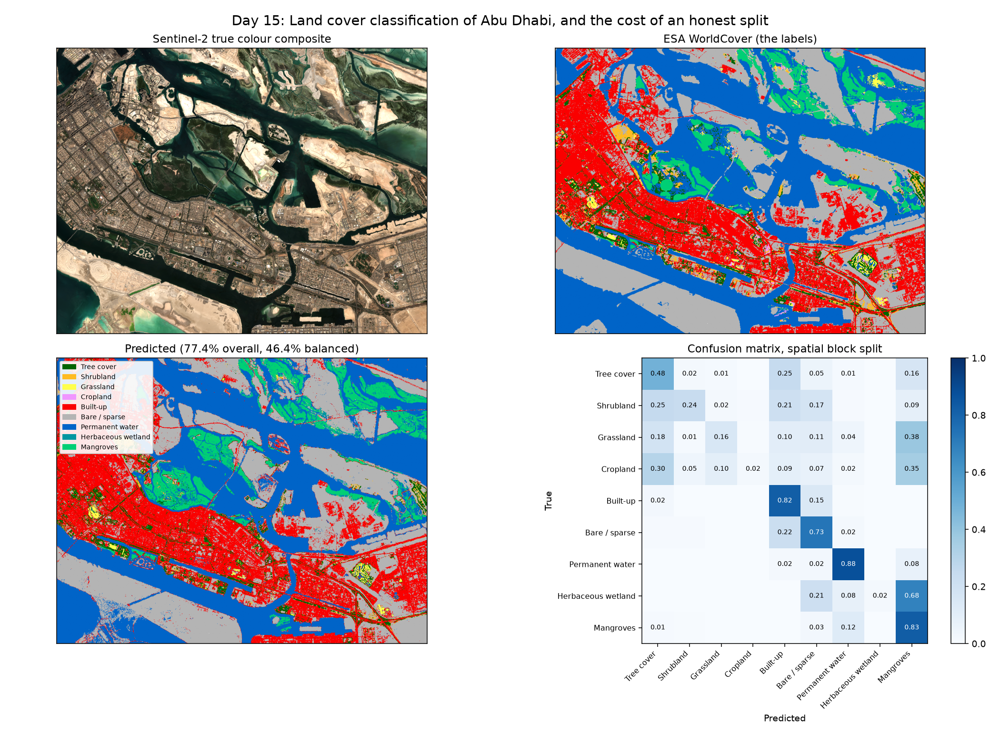

# Day 15: A Land Cover Map of Abu Dhabi, and Why Random Splits Lie

Day 13 ended with a conclusion: the features were the ceiling, not the forest. This tests that by giving the model everything RGB was missing, on a real scene rather than pre-cut benchmark chips.



## What changed since Day 05

| | Day 05 | Day 15 |
|---|---|---|
| Input | 64x64 RGB JPEG chips | a real Sentinel-2 scene |
| Features | 17 colour statistics | 10 bands + NDVI, NDWI, MNDWI, NDBI |
| Labels | the EuroSAT folder name | ESA WorldCover, a global 10 m product |
| Evaluation | one random split | spatial blocks, and the random split for comparison |

The scene is the Abu Dhabi coast from Days 01 and 07, chosen because it contains four things that are genuinely hard to tell apart from colour alone: mangroves, open water, dense city, and bare desert. WorldCover has a dedicated **Mangroves** class, so this is the same question Day 01 asked with a threshold, now asked properly.

## Neighbouring pixels are not independent

A random pixel split puts a pixel in the training set and the pixel immediately touching it in the test set. At 20 m those two are very nearly the same measurement of the same thing. A model can score beautifully by memorising, and the resulting accuracy says nothing about whether it would work anywhere new.

Splitting by **spatial blocks** fixes it. The scene is cut into a 6x6 grid, a third of the blocks are held out whole, and the model is tested on ground it has never seen any part of.

The self-test shows how large this effect can get. It builds an image where the features are **pure noise** and the label depends only on which quadrant a pixel sits in, so there is genuinely nothing learnable:

```
random pixel split  ->  99.5%
spatial block split ->   0.0%
```

Ninety-nine points of accuracy, entirely fabricated by the split. That is the extreme case, but every spatial dataset has some of it.

## A class can vanish without an error

A pixel is dropped if any feature is non-finite, and a spectral index whose denominator comes out at zero produces exactly that. It is easy to do to a whole class at once, because an index that is undefined for deep water is undefined for *every* water pixel in the scene.

The class then disappears from the results silently. No exception, no warning, just a confusion matrix that quietly has one fewer row than it should. The script now reports per-class pixel loss and warns above 20%, after a synthetic test lost 100% of the water class without saying anything.

## Overall accuracy is the wrong headline

Three classes (water, bare ground, built-up) make up most of this scene, and they are also the easiest to tell apart spectrally. Overall accuracy weights every pixel equally, so it mostly reports whether the model found the water.

Balanced accuracy averages recall across classes instead, giving a rare class the same vote as a common one. The gap between the two numbers is how much of the headline was carried by the easy majority.

The illustration is simple: on a dataset that is 90% one class, a model that predicts that class and nothing else scores 90% overall and 50% balanced.

The per-class recalls are where the real behaviour is. The rare vegetation classes get collapsed into whichever common class they most resemble, and cropland in particular is mostly labelled as mangrove, because both are small irrigated green patches and the spectra at 20 m are close.

## Results

Scene: Abu Dhabi coast, 1030 x 795 px at 20 m, 818,841 usable pixels.
Composite from 3 clear days (Sep to Oct 2024). Labels: ESA WorldCover 2021 v200.

| Split | Accuracy |
|---|---|
| Random pixel | 80.46% |
| Spatial block (12 of 36 blocks held out) | 77.42% |
| Gap (leakage) | 3.04 points |

| Features, block split | Accuracy |
|---|---|
| RGB only | 68.93% |
| All 14 | 77.42% |
| Gain from infrared and indices | +8.49 points |

Most useful features: B12 (17.6%), B11 (11.6%), NDWI (10.0%), B8A (8.8%), MNDWI (8.6%). All SWIR or water indices, none of them available in RGB.

| Metric, block split | Value |
|---|---|
| Overall accuracy | 77.42% |
| Balanced accuracy | 46.40% |
| Macro F1 | 46.94% |

Per-class recall on held-out blocks:

| Class | Recall | Test pixels |
|---|---|---|
| Permanent water | 87.6% | 13,260 |
| Mangroves | 82.7% | 2,331 |
| Built-up | 82.0% | 10,497 |
| Bare / sparse | 73.4% | 10,367 |
| Tree cover | 48.3% | 1,790 |
| Shrubland | 23.9% | 872 |
| Grassland | 15.5% | 490 |
| Herbaceous wetland | 2.2% | 135 |
| Cropland | 2.0% | 198 |

Three classes hold 85% of the test pixels. Mean recall on those is 81.0%; on the six rare classes it is 29.1%. Cropland is mostly predicted as mangroves, since both are small irrigated green patches whose spectra are close at 20 m.

## What I learned

A random train/test split can overestimate performance badly when neighbouring pixels carry nearly the same information. The synthetic test makes the extreme case concrete: with features that were pure noise and labels that depended only on position, a random split scored 99.5% and a block split 0.0%.

On the real scene the gap was only 3.04 points, which surprised me. The reason is that this model is learning spectra rather than position: "water is dark in SWIR" is true everywhere in the image, so it transfers to ground the model has never seen. Spatial leakage is large when a model memorises local texture and small when the signal is genuinely physical.

Adding the infrared bands and indices was worth +8.49 points on the honest split, and the five most useful features were all SWIR bands or water indices, none of which exist in RGB. That confirmed what Day 13 predicted about the features being the ceiling.

The thing I had not thought about is that overall accuracy can hide almost everything. 77.42% overall against 46.40% balanced, because three classes hold 85% of the pixels and they are the easy ones. Mean recall is 81.0% on those three and 29.1% on the other six, with cropland found 2% of the time and mostly called mangrove instead.

## Run it

```bash
python landcover_map.py
```

Downloads three Sentinel-2 dates and one WorldCover tile, so give it a few minutes.

## Limitations and next steps

- **WorldCover is a model output, not ground truth.** It is roughly 75% accurate globally, so this measures agreement with another classifier, not correctness. Where the two disagree, either could be the one that is wrong.
- 6x6 blocks is a coarse choice. The honest version sweeps the block size and reports accuracy as a function of it, since the gap shrinks as blocks grow and that curve is the real answer.
- The composite is three dates from one year. Day 09 showed that land cover classes have different signatures through a year, and a multi-season stack would separate the vegetation classes better than any single composite can.

## Data

Sentinel-2 L2A and ESA WorldCover, Copernicus / ESA, accessed via Microsoft Planetary Computer.
