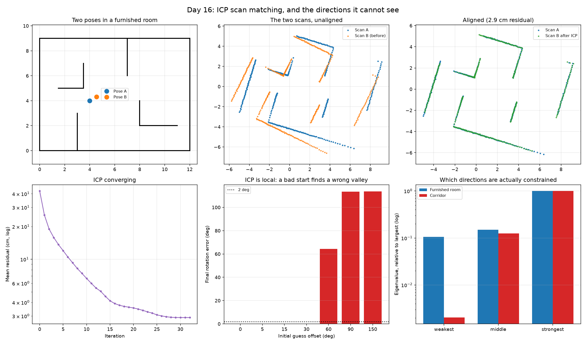

# Day 16: ICP Scan Matching, and the Directions It Cannot See

Day 12 built a map assuming the pose was known. Day 14 found the pose assuming the map was known. Neither holds on a robot that has just been switched on, and scan matching is what bridges them: work out how far the robot moved by aligning the scan it just took against the previous one. No map, no features, no landmarks.



## The algorithm

Iterative Closest Point, in three lines:

1. for every point in the new scan, find the nearest point in the old one
2. solve for the rigid transform that best lines up those pairs
3. apply it, and repeat

Step 2 has an exact closed-form answer. Centre both clouds, take the SVD of their cross-covariance, and the optimal rotation falls out. This is the **Kabsch algorithm**, and there is nothing in it to tune.

```
H = (source - centre_s)ᵀ (target - centre_t)
U, S, Vᵀ = svd(H)
R = Vᵀᵀ · diag(1, det(VᵀᵀUᵀ)) · Uᵀ
```

That determinant term matters. Without it the SVD will happily return a **reflection**, which fits the points just as well and is not a rotation a robot can perform.

Step 1 is the weak part. Nearest neighbour is a guess, and it only becomes a good guess once the clouds are already roughly aligned.

## ICP is local, and it does not tell you when it fails

Because correspondences come from nearest neighbour, ICP walks downhill from wherever it starts. Rotate the initial guess far enough and it finds a different valley:

| Initial guess offset | Final residual | Rotation error |
|---|---|---|
| 0 to 30 degrees | 2.91 cm | under 0.1 degrees |
| 60 degrees | 74.87 cm | 64.24 degrees |
| 90 and 150 degrees | ~55 cm | ~114 degrees |

The cliff is sharp and sits somewhere between 30 and 60 degrees for this scene. In practice the initial guess comes from odometry, which is exactly why a robot with no wheel encoders is much harder to work with than one that has them.

## The corridor

Here is the result worth remembering. The same algorithm, in a 40 m corridor with nothing in it, with the robot sliding 0.8 m along its length:

| | Along the corridor | Across it |
|---|---|---|
| True motion | +0.800 m | 0.000 m |
| ICP's answer | **-0.001 m** | 0.000 m |

ICP reports that the robot did not move. It moved 0.8 m.

And the mean residual was **1.56 cm**, *better* than the 2.91 cm it achieved in the room where it got the right answer. The best-looking fit in this whole exercise is the completely wrong one, because sliding along a featureless corridor produces an identical scan. There is no residual to minimise in that direction, so every answer is equally good and ICP returns whatever it started with.

A residual cannot detect this. It measures how well the points line up, and they line up perfectly.

## What can detect it

Build the information matrix from the point-to-plane Jacobian. For each matched point, the residual that actually constrains anything is the distance along the local surface normal, because sliding a point along a wall changes nothing. The eigenvalues of JᵀJ then say how much evidence each direction of motion has:

| | Eigenvalues (weakest to strongest) | Condition number |
|---|---|---|
| Furnished room | 146.5, 206.7, 1383.0 | 9.4 |
| Corridor | 5.4, 332.6, 2669.6 | 492.7 |

The corridor's smallest eigenvalue is the direction along it, and it is 50 times smaller relative to its largest than the room's is. That number is computable **before** trusting the result, from the scan geometry alone, with no ground truth needed.

A straight line taken on its own gives a smallest eigenvalue of exactly zero, which the self-test checks.

## Checking it before trusting it

- Kabsch must recover a transform applied on purpose, exactly, when the correspondences are known. It does, to 1e-9.
- The determinant guard must keep the result a rotation when handed a reflected cloud.
- Full ICP, with correspondences unknown and the points shuffled and noised, must still recover the transform. Error: 0.0004 m and 0.0022 degrees.
- The information matrix must report a zero eigenvalue for a single straight line.

## Results

Two scans of 360 points each from a furnished room.
True motion: 0.550 m, 0.320 m, 9.0 degrees.

**Cold start (identity initial guess)**

| Measure | Value |
|---|---|
| Iterations to converge | 33 |
| Mean residual | 2.91 cm |
| Estimated rotation | +8.93 degrees (true +9.00) |
| Rotation error | 0.073 degrees |

**Sensitivity to the initial guess**

| Offset | Final residual | Rotation error | |
|---|---|---|---|
| 0 deg | 2.91 cm | 0.07 deg | converged |
| 5 deg | 2.91 cm | 0.07 deg | converged |
| 15 deg | 2.91 cm | 0.03 deg | converged |
| 30 deg | 2.91 cm | 0.03 deg | converged |
| 60 deg | 74.87 cm | 64.24 deg | wrong answer |
| 90 deg | 55.04 cm | 113.51 deg | wrong answer |
| 150 deg | 55.11 cm | 113.76 deg | wrong answer |

**The corridor**

| | Along | Across |
|---|---|---|
| True motion | +0.800 m | 0.000 m |
| ICP's answer | -0.001 m | 0.000 m |
| Error | 0.801 m | |

Mean residual in the corridor: 1.56 cm, better than the 2.91 cm achieved in the room where the answer was right.

**Information matrix eigenvalues**

| Scene | Weakest | Middle | Strongest | Condition number |
|---|---|---|---|---|
| Furnished room | 146.5 | 206.7 | 1383.0 | 9.4 |
| Corridor | 5.4 | 332.6 | 2669.6 | 492.7 |

Self-tests: Kabsch exact to 1e-9, reflection guard holds determinant at +1, full ICP recovers a known transform to 0.0004 m and 0.0022 degrees, and a single straight line gives a smallest eigenvalue of exactly zero.

## What I learned

ICP can report a very low alignment error while being completely wrong about how far the robot moved. In the corridor it estimated -0.001 m when the true motion was 0.8 m, and the residual for that answer was 1.56 cm, better than the 2.91 cm it achieved in the room where it got the right answer. A residual measures whether the points line up, and in a featureless corridor they line up perfectly for every possible amount of sliding.

That taught me the distinction I had been missing: some directions of motion are not determined by scan geometry at all, no matter how good the alignment looks. It is a property of the scene, not of the algorithm or the amount of effort spent on it.

Two things follow. A good initial guess matters, because ICP only walks downhill from wherever it starts: it converged to within 0.1 degrees from offsets up to 30 degrees and returned 64 and 114 degree errors at 60 and 90. And the eigenvalues of the information matrix identify the unreliable directions in advance, from the scan alone, with no ground truth: condition number 9.4 in the furnished room against 492.7 in the corridor. A robot should check that number and fall back to another sensor for the degenerate direction rather than trusting the estimate.

## Run it

```bash
python icp_scan_matching.py
```

Pure NumPy and SciPy, no download, a few seconds.

## Limitations and next steps

- This is point-to-point ICP. Point-to-plane converges in far fewer iterations on structured scenes like these, and the Jacobian for it is already written here for the information matrix.
- Chaining scan matches frame to frame gives lidar odometry, which drifts, in the same way Day 10's dead reckoning drifted. The fix is the same: recognise somewhere you have been before and close the loop. That is the last missing piece of SLAM.
- The degeneracy test should gate the estimate rather than just report it. A sensible system refuses to use the unobservable component and falls back to odometry for that direction, instead of accepting an invented number.
