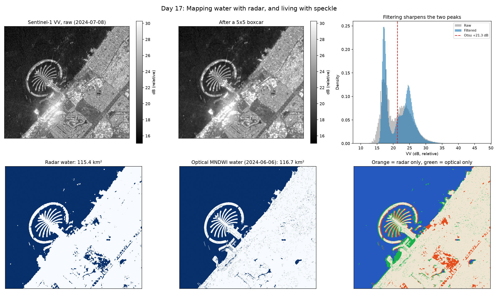

# Day 17: Mapping Water with Radar, and Living with Speckle

Every geospatial day so far has used an optical sensor: sunlight bouncing off a surface, measured in bands. Sentinel-1 is a different instrument. It is a radar that brings its own illumination, so it works at night and straight through cloud, and what it measures is how much of its own pulse the surface sends back.



## Water is dark, and that is physics

In the optical days, water was found with an index: a ratio of bands chosen because it happened to separate water from everything else.

Radar does not need one. A calm water surface is **specular**: it reflects the incoming pulse away from the satellite like a mirror angled wrong, so almost nothing returns. Water is simply black. Rough surfaces scatter in all directions, including back at the sensor, so land is bright.

That makes radar water detection far more robust than an optical index, and it keeps working at night, under cloud, and during the storm that caused the flood you are trying to map.

## Speckle is not optical noise

The catch is severe, and treating it like sensor noise does not work.

Each SAR pixel sums the returns from many scatterers whose waves arrive with random phases. They interfere, and the result is **multiplicative** noise with a very specific property: for fully developed single-look speckle in intensity, the standard deviation **equals the mean**. The coefficient of variation is exactly 1.

A quantity whose noise is as large as its signal is not usable pixel by pixel. The fix is to average independent looks, which cuts the standard deviation by the square root of how many you average.

This is checkable against closed-form theory rather than by eye, so the self-test does exactly that:

| Filter | Measured CV | Theory |
|---|---|---|
| none (1 look) | 1.005 | 1.000 |
| 3x3 boxcar | 0.336 | 0.333 |
| 5x5 boxcar | 0.203 | 0.200 |
| 9x9 boxcar | 0.115 | 0.111 |

Three decimal places of agreement with the square root law. The test also confirms the filter preserves the mean, so it reduces noise without inventing signal.

Everything is done in **dB**, which is not cosmetic: a log transform turns multiplicative noise into additive noise, which is what makes a histogram threshold meaningful at all.

## What the numbers are, and are not

These are GRD products, whose values are **digital numbers, not calibrated sigma-nought**. Converting them to dB gives a relative scale.

That is enough for this task, because thresholding only needs water to be darker than land by a wide margin, which it is regardless of absolute calibration. It is not enough to quote as physical backscatter, and this README does not. Calibrated values would need the RTC collection, which requires an account.

## Radar against optical

The last panel puts the radar water mask beside the MNDWI mask from the same coastline Day 03 used, and marks where the two disagree.

They are different instruments, measuring different physics, from different orbits, on different dates. Where they agree, that is two independent methods confirming each other. Where they disagree is the interesting part: wet sand reads as water to one and not the other, very calm pools can look specular to radar, and anything that actually changed between the two dates shows up as a difference that is not an error at all.

## Results

Scene: S1A_IW_GRDH_1SDV_20240708T021551, 2024-07-08, descending orbit, IW mode.
818 x 732 px at 20 m over the Dubai coast.

**Speckle, self-test against closed-form theory**

| Filter | Measured CV | Theory |
|---|---|---|
| none (1 look) | 1.005 | 1.000 |
| 3x3 boxcar | 0.336 | 0.333 |
| 5x5 boxcar | 0.203 | 0.200 |
| 9x9 boxcar | 0.115 | 0.111 |

**On the real scene**

| Measure | Value |
|---|---|
| CV unfiltered | 2.005 |
| CV after 5x5 boxcar | 1.269 (1.6x less variable) |
| Otsu threshold | +21.25 dB (relative) |
| Water area, filtered | 115.36 km² |
| Water area, unfiltered | 126.98 km² |

The whole-scene CV sits above 1.0 because it mixes genuine variation between surfaces with speckle. The unfiltered water area is 11.6 km² larger because dark speckle on land crosses the threshold.

The positive threshold is itself informative: calibrated water backscatter is around -20 dB, so +21.25 dB confirms these are digital numbers on a relative scale, not sigma-nought.

**Radar against optical**

| | Area |
|---|---|
| Optical (MNDWI, 2024-06-06) | 116.69 km² |
| Radar (2024-07-08) | 115.35 km² |
| Agreement | 91.91% of pixels |
| Radar only | 9.01 km² |
| Optical only | 10.35 km² |

Two instruments, different physics, a month apart, agreeing on the total to within 1.3 km². The disagreements are structured rather than random: orange patches inland are radar shadow behind tall buildings, which is dark for the same reason water is, and green along the shoreline and Palm edges is wet sand and shallow water.

## What I learned

Sentinel-1 finds water through cloud and at night, and it does it by physics rather than by an index: a calm surface is specular, so it reflects the pulse away from the satellite and comes back black. That makes it more robust than an optical index, which is exactly why it is the sensor used for flood mapping, where the cloud causing the flood blinds everything optical.

Speckle is the price. It is multiplicative rather than additive, and for single-look intensity the standard deviation equals the mean, which means a coefficient of variation of exactly 1. That is a number I could check rather than take on trust: simulated speckle came out at 1.005, and averaging a w by w window cut it by w, 0.336, 0.203 and 0.115 against a predicted 0.333, 0.200 and 0.111. Filtering costs sharpness at boundaries, so it is a trade rather than a fix.

The detail I nearly missed was the threshold coming out at +21.25 dB. Calibrated water backscatter sits near -20 dB, so a positive number is evidence that GRD values are digital numbers on a relative scale and not sigma-nought. Thresholding does not care, since water is still far darker than land, but quoting that figure as backscatter would have been wrong.

Radar and optical agreed on 91.91% of pixels and on total water area to within 1.3 km², a month apart, measuring entirely different things. The disagreements were structured rather than random: radar shadow behind tall buildings is dark for the same reason water is, so a threshold cannot tell them apart, and wet sand along the shoreline reads as water to one sensor and not the other. Two sensors disagreeing in an explainable way is more informative than either one alone.

## Run it

```bash
python sar_water.py
```

One Sentinel-1 scene and one Sentinel-2 scene, so a few minutes.

## Limitations and next steps

- A boxcar filter blurs edges along with the speckle. A Lee or refined Lee filter adapts to local statistics and keeps coastlines sharp, which matters if the output is a shoreline rather than an area.
- GRD is not terrain corrected. On this flat coast that is harmless; in the Hajar mountains from Day 11 the same data would suffer badly from foreshortening and layover.
- Wind roughens water, which raises its backscatter and can make it stop looking like water entirely. A single scene cannot tell a windy day from a dry lake bed.
- The real use for this is flood mapping, where optical sensors are blinded by the cloud that caused the flood. Differencing a before and after pair, the way Day 07 did with NDVI, is the natural next step.

## Data

Sentinel-1 GRD and Sentinel-2 L2A, Copernicus / ESA, accessed via Microsoft Planetary Computer.
