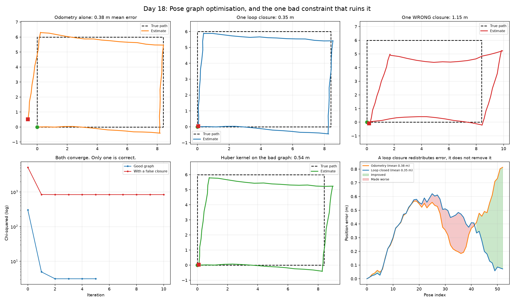

# Day 18: Pose Graph Optimisation, and the One Bad Constraint That Ruins It

Day 16 ended by naming what was still missing. Scan matching gives the motion between consecutive poses, but chaining those estimates carries every small error forward forever, exactly like the dead reckoning in Day 10. The trajectory drifts and the map does not close.

The fix is to notice when the robot returns somewhere it has been, and add a constraint saying so.



## The optimisation

Every pose is a variable, every measurement is a constraint, and the whole thing is solved at once by Gauss-Newton:

```
for each constraint (i, j, z):
    e   = error between what the graph implies and what was measured
    A,B = derivatives of e with respect to pose i and pose j
    H  += Aᵀ Ω A  (and the other three blocks)
    b  += Aᵀ Ω e
solve H dx = -b,  apply, repeat
```

Two details decide whether this works at all.

**The first pose must be held fixed.** Sliding or rotating the entire map changes no relative measurement, so without an anchor the problem is under-determined and `H` is singular. This is gauge freedom, and it is not optional.

**Angles must be wrapped.** An error of 350 degrees and an error of -10 degrees are the same rotation, and an optimiser handed the first will take an enormous correction to fix a small problem.

## A loop closure redistributes error, it does not remove it

This is the result that changed how I was thinking about it.

Adding one loop closure to a 52-step trajectory:

| Measure | Odometry alone | With loop closure |
|---|---|---|
| Gap at the loop | 0.813 m | 0.072 m (91% closed) |
| Final position error | 0.813 m | 0.072 m |
| **Mean position error** | **0.385 m** | **0.349 m (only 9% better)** |

The loop closes beautifully and the mean error barely moves. Looking per pose, **16 poses got closer to the truth and 37 got further away**. The bottom-right panel shows it directly: a band of red where the optimisation made things worse, and green where it helped.

That is not a failure. One extra measurement cannot undo 52 steps of accumulated noise, and it was never going to. What it does is make the map **consistent**: the robot now agrees with itself about where it has been. For mapping that is the thing that matters, because an inconsistent map draws the same wall twice in two different places.

## One wrong constraint is worse than none

| Graph | Mean position error |
|---|---|
| Odometry alone | 0.385 m |
| With a correct loop closure | 0.349 m |
| With one **false** loop closure | 1.151 m |
| False closure, with a Huber kernel | 0.539 m |

A single wrong constraint, out of 54, made the result **three times worse than having no loop closure at all**. Least squares has no mechanism for disbelief: it cannot reject a measurement, only split the difference between all of them, so one confident lie drags every other pose toward it.

A **Huber kernel** fixes most of it. Beyond a threshold the cost grows linearly rather than quadratically, so a single large error stops dominating. It recovered 76% of the damage here.

## Unlike Day 16, this failure is visible

Day 16's corridor was the bad case: a wrong answer with an excellent residual, undetectable from the fit alone.

A poisoned pose graph is not like that. The healthy graph settles at a chi-squared of 3.1; the poisoned one plateaus at 845, **270 times higher**. A converged optimisation still carrying a large residual is telling you its constraints contradict each other.

That is worth knowing because it is actionable: the check is free, and it fires before the map gets used for anything.

## Checking it before trusting it

- SE(2) conversions round-trip exactly, and relative poses compose back to the pose they came from.
- `wrap(350 degrees)` returns -10 degrees.
- **The analytic Jacobians are checked against finite differences**, agreeing to 1.8e-09. This is the test that earns its place: a wrong Jacobian does not crash, it just quietly fails to converge, and that looks like a tuning problem rather than a bug.
- A graph built from perfect measurements starts at a chi-squared of 7.9e-31, confirming the error function is zero when it should be.
- Optimisation never increases the cost.

## Results

53 poses around a closed rectangular loop, 52 odometry constraints.

**Odometry alone**

| Measure | Value |
|---|---|
| Mean position error | 0.385 m |
| Final position error | 0.813 m |
| Gap at the loop | 0.813 m |

**With one loop closure**

| Measure | Value |
|---|---|
| Iterations to converge | 6 |
| Chi-squared | 304.8 → 3.1 |
| Gap at the loop | 0.813 m → 0.072 m (91% closed) |
| Final position error | 0.813 m → 0.072 m |
| Mean position error | 0.385 m → 0.349 m (9% better) |

Per pose: 16 got closer to the truth, 37 got further away. The loop closes while the mean barely moves, because one constraint redistributes error rather than removing it.

**One false loop closure, claiming pose 8 and pose 30 are the same place**

| Graph | Mean position error |
|---|---|
| Odometry alone | 0.385 m |
| Correct loop closure | 0.349 m |
| One false closure | 1.151 m |
| False closure + Huber kernel | 0.539 m |

One bad constraint out of 54 made the result 3.0x worse than having no loop closure at all. A Huber kernel recovered 76% of the damage.

**Detectability**

Chi-squared after convergence: 3.1 for the healthy graph, 845 for the poisoned one, 270x higher. Unlike Day 16's corridor degeneracy, this failure shows up in the residual.

**Self-tests**

SE(2) round trip and composition exact; `wrap(350°) = -10°`; analytic Jacobians agree with finite differences to 1.79e-09; a perfect graph starts at chi-squared 7.91e-31; optimisation never increases cost.

## What I learned

Pose graph optimisation is not about making every estimated position more accurate. It is about making the trajectory consistent with itself. One loop closure cut the drift at the loop by 91%, from 0.813 m to 0.072 m, while the mean error over all poses moved only 9%. Looking per pose, 16 got closer to the truth and 37 got further away: the error was redistributed around the loop, not removed. One extra measurement was never going to undo 52 steps of accumulated noise, and consistency is the thing a map actually needs, because an inconsistent one draws the same wall twice.

The bigger lesson was how much damage a single false loop closure does. One wrong constraint out of 54 made the result 1.151 m, three times worse than having no loop closure at all, because least squares has no way to disbelieve a measurement. It can only split the difference, so one confident lie drags every other pose toward it. A Huber kernel recovered 76% of that.

An optimiser converging does not mean the answer is right, and checking the residual afterwards matters. Here that check works: the healthy graph settled at a chi-squared of 3.1 and the poisoned one at 845. Worth contrasting with Day 16, where ICP in a corridor produced a wrong answer with a *better* residual than the correct one. Whether a failure is visible in the diagnostics is a property of the method, and worth establishing before relying on either.

## Run it

```bash
python pose_graph.py
```

Pure NumPy, no download, a few seconds.

## Limitations and next steps

- `H` is built dense here. Real pose graphs are sparse, and solving them with a sparse Cholesky factorisation is what makes thousands of poses tractable.
- The loop closure is handed to the optimiser rather than discovered. Finding it is place recognition, which is a perception problem and the source of the false closures this day is about.
- Switchable constraints go further than a Huber kernel: they give the optimiser a per-constraint weight it can drive to zero, so it can decide a loop closure was wrong rather than merely downweighting it.
- Connecting this to Day 16 would give full SLAM: scan matching produces the odometry constraints, matching against older scans proposes the loop closures, and this solves the result.
