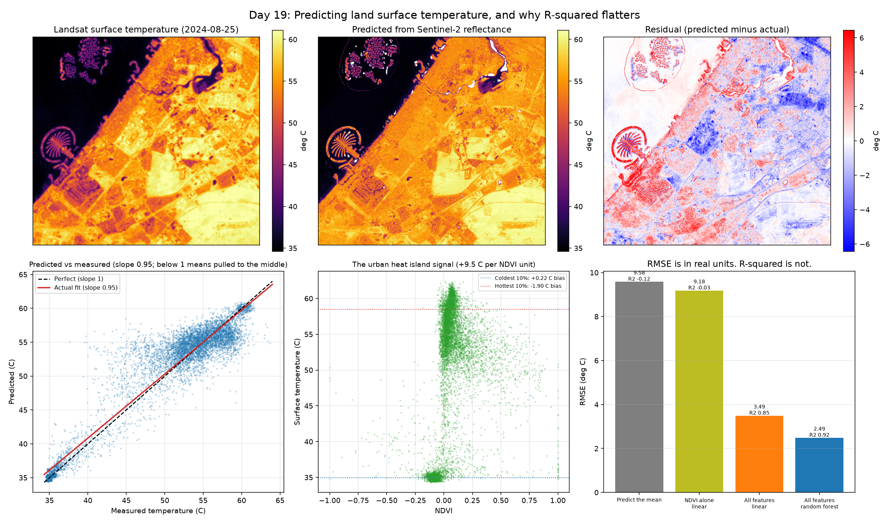

# Day 19: Predicting Land Surface Temperature, and Why R-squared Flatters

Nine geospatial days so far, and every one of them has been classification or thresholding: is this pixel water, is it mangrove, which of ten classes is it. This one predicts a continuous number instead, which brings different metrics and a different set of ways to be wrong.



## The problem

**Target:** land surface temperature from Landsat Collection 2's thermal band, in degrees Celsius.
**Predictors:** Sentinel-2 reflectance from a date within a few days.

The physics is the urban heat island. Vegetation cools itself by evaporating water, so green pixels run cooler than concrete ones, That is what I expected to find. It is not what the data gave back, which turned out to be the more interesting result. Over Dubai in summer, the contrast between a park and a car park is tens of degrees.

Matching the dates matters more than usual. Surface temperature changes completely between one day and the next, so predicting July's temperature from May's reflectance would be measuring nothing at all. The script searches for a Landsat and Sentinel-2 pair within eight days and refuses to run without one.

## R-squared is not a property of the model

This is the part worth taking away.

R-squared asks how much of the target's variance the model explains. That means it depends on how variable the target is, which is a property of the **scene**, not of the model. The self-test makes it concrete with an identical model and identical error:

| Target spread | RMSE | R-squared |
|---|---|---|
| 2.0 C | 2.02 C | **-0.022** |
| 5.0 C | 2.01 C | **0.837** |
| 12.0 C | 2.02 C | **0.972** |

The same 2 degree error reads as useless, decent, and excellent, depending entirely on how much the scene varied. A paper reporting R-squared of 0.97 on a high-contrast desert city is not necessarily doing better than one reporting 0.84 somewhere flatter.

**RMSE and MAE are in degrees.** They are comparable across studies, interpretable by anyone, and they do not flatter. R-squared is still useful for comparing models on *one* dataset, which is why it is reported here alongside the others rather than instead of them.

## Baselines before models

An accuracy number means nothing without something to beat. Three baselines, all evaluated on spatially held-out blocks (the Day 15 lesson, because neighbouring pixels are nearly the same measurement):

1. **Predict the mean.** R-squared of 0 by construction on the training distribution, and slightly negative on held-out blocks because their mean differs.
2. **NDVI alone, linear. One predictor, carrying the physical story. I expected a negative coefficient, greener is cooler. It came out positive, see Results.
3. **All features, linear**, then **all features, random forest.**

The gap between step 2 and step 4 is what the extra machinery is actually worth.

## The error that averages to zero

A model fitted to minimise squared error pulls its predictions toward the middle of the range. The consequence is specific and easy to miss:

- bias in the coldest 10% of pixels: **positive** (over-predicted)
- bias in the hottest 10% of pixels: **negative** (under-predicted)
- bias overall: **near zero**, because those two cancel

An overall bias near zero looks like a well-calibrated model. It is hiding two opposite errors, and an urban heat island study is interested in precisely the extremes that are wrong. The script reports all three figures and only claims the shrinkage when the signs actually come out opposite.

## Checking it before trusting it

- The Landsat scaling is checked against reference points computed from the published scale and offset, not guessed: digital number 44000 must give 26.24 C, 50000 must give 46.75 C, to within 0.05 C. Getting this wrong does not raise an error, it produces a plausible-looking map that is wrong by tens of degrees.
- QA_PIXEL cloud bits decode correctly.
- R-squared is exactly 0 for predicting the mean and exactly 1 for a perfect fit.
- The R-squared table above is generated by the test, not typed in.
- A least squares fit demonstrably shrinks the spread of its predictions.

## Results

Landsat 9 and Sentinel-2 both on 2024-08-25, 0 days apart, over Dubai.
1022 x 937 pixels at 30 m, 99.3% usable. Surface temperature 34.1 to 65.7 C.
Validated on 12 of 36 spatial blocks held out, 40,002 test pixels.

| Model | R-squared | RMSE | MAE | Bias |
|---|---|---|---|---|
| Predict the mean | -0.120 | 9.58 C | 7.40 C | +3.13 C |
| NDVI alone, linear | -0.028 | 9.18 C | 7.38 C | +2.96 C |
| All features, linear | 0.852 | 3.49 C | 2.61 C | +0.03 C |
| All features, random forest | 0.925 | 2.49 C | 1.65 C | +0.36 C |

NDVI slope: +9.48 C per unit NDVI.
Most useful predictors: B12 (90%), NDBI (2%), B11 (2%), NDWI (2%).

| Error at the extremes | Bias |
|---|---|
| Coldest 10% of pixels | +0.22 C |
| Hottest 10% of pixels | -1.90 C |
| Overall | +0.36 C |


## What I learned

A high R-squared does not mean a model is accurate, because it depends on how much the target varies. My self-test proves it: the same 2.0 C error scores -0.022, 0.837 and 0.972 depending only on the spread of the truth. RMSE and MAE are in degrees, so they say what the error actually is. Predicting the mean scored -0.120 rather than 0, because the mean came from the training blocks and was the wrong constant for the held-out ones.

Checking the errors at the extremes mattered more than the overall number. The overall bias of +0.36 C looks well calibrated, but it is hiding a +0.22 C over-prediction in the coldest decile and a -1.90 C under-prediction in the hottest, which cancel in the average. An urban heat study cares about exactly the hot extreme the model gets worst.

NDVI alone was nearly useless and ran the opposite way to the textbook, +9.48 C per NDVI unit. The greener-is-cooler relationship needs vegetation to exist, and in a desert city the NDVI axis runs water to bare sand. What actually carried the model was B12, taking 90% of the forest's splits: SWIR tracks surface material and dryness, and that is what sets temperature here.

## Run it

```bash
python lst_regression.py
```

One Landsat scene and one Sentinel-2 scene, then a random forest over the full image, so a few minutes.

## Limitations and next steps

- Landsat's thermal band is acquired at 100 m and resampled to 30 m, so the fine detail in the temperature map is not really there. Predicting it at 30 m is partly predicting an interpolation.
- One date. The relationship between vegetation and temperature changes completely between summer and winter, and a model fitted in July says little about January.
- Surface temperature is not air temperature. They are related but not interchangeable, and the difference is large over hot dry surfaces.
- Quantile regression would predict the extremes honestly instead of shrinking them, which is the right tool if the extremes are the point.

## Data

Landsat Collection 2 Level-2 (USGS) and Sentinel-2 L2A (Copernicus / ESA), via Microsoft Planetary Computer.
